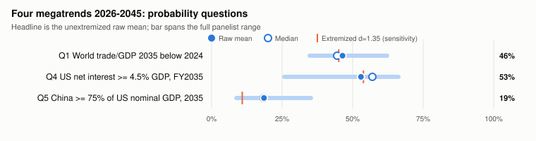
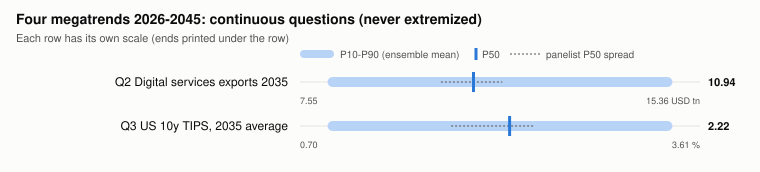
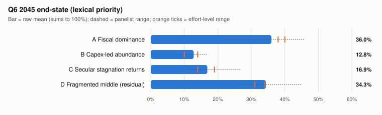

# Four megatrends, 2026-2045: Tetlock ensemble forecast

**Forecast origin:** 2026-11-07 &nbsp;|&nbsp; **Panel:** 4 independent efforts x 6 single-skill seats = 24
&nbsp;|&nbsp; **Method:** `.claude/skills/tetlock-ensemble-forecasting`

> ## Bottom line up front
>
> **The binding constraint of 2026-2045 is US fiscal arithmetic, not electrification, AI or
> demography taken one at a time.** US net interest reaching 4.5% of GDP in FY2035 is slightly
> more likely than not: **53% raw mean, 57% median**. All four effort calibrators sit at 54-59%.
> Fiscal dominance is the modal 2045 end-state at **36%**, narrowly ahead of a "fragmented
> middle" at **34%**. The US 10-year TIPS yield averages **2.22% in 2035 (P50; P10-P90
> 0.90-3.40)**: below today's ≈2.9% spike, but well above the 2010s, so secular stagnation does
> not return by default (**17%**). Trade openness in 2035 is a near coin-flip (**46%** that it is
> lower than in 2024). Digital services roughly double to **$10.9T**, and China re-reaching 75% of
> US nominal GDP is a long shot (**19%**).

### Scorecard (headline = unextremized raw mean and median)

| Q | Question (resolves) | Raw mean | Median | Effort range (4 calibrators) | *Sensitivity, d=1.35* |
|---|---|---|---|---|---|
| Q1 | World trade/GDP 2035 < 2024 (WDI, 2037) | **46%** | 45% | 41-54% | *45%* |
| Q4 | US net interest >= 4.5% GDP, FY2035 (CBO, 2036) | **53%** | 57% | 54-59% | *54%* |
| Q5 | China >= 75% of US nominal GDP, 2035 (IMF WEO Oct-2036) | **19%** | 19% | 17-24% | *11%* |
| Q6 | 2045 regime: A fiscal dominance / B capex-led abundance / C secular stagnation / D fragmented middle | **36 / 13 / 17 / 34** | 38 / 13 / 16 / 33 | A 38-40, B 10-14, C 14-19, D 31-34 | - |

| Q | Continuous quantity | Ensemble mean P10 / P50 / P90 | Ensemble median P10 / P50 / P90 |
|---|---|---|---|
| Q2 | Digitally delivered services exports, 2035, USD tn (WTO) | **8.09 / 10.94 / 14.82** | 8.10 / 10.90 / 14.75 |
| Q3 | US 10y TIPS (`DFII10`), 2035 average, % | **0.90 / 2.22 / 3.40** | 0.90 / 2.27 / 3.40 |

**Two signposts that would flip the call.**
1. **Where the 10-year settles in 2027-28.** The fiscal lean rests on market yields sitting
   ≈60-100bp above CBO's assumed 4.1-4.4% path while most debt reprices before 2035. A reversal
   like October 2023's (≈100bp in ten weeks) that holds would pull Q4 back below 50 and lift C.
2. **The 2027-29 AI-capex refinancing wall.** A bust (red teams put it at 20-35%) lowers rates
   *and* trade value and lifts the renminbi. A sustained boom does the opposite. It is the
   single shock that moves Q1, Q3, Q5 and Q6 together.

**Biggest measurement caveat.** Q1, Q2 and Q5 are nominal-dollar ratios, so exchange rates and
commodity prices move them as much as volumes do. Every Wave-1 seat in Efforts 1 and 2 assumed
a neutral dollar, and both red teams landed that hit. Also, the 4.5% threshold in Q4 is CBO's
own 2035 baseline, so Q4 is a bet on CBO's error, not on the trend.

---

## 1. What the panel says about how the four trends interact

**Rates and capital scarcity (Q3, Q6-C).** All four efforts converge on a real yield that falls
back from the 2026 spike but does not return to the 2010s (effort P50s 2.15-2.33%). Three
front-loaded demands for capital coincide over 2026-2035:
- AI and datacenter capex, about 1.8% of US GDP in 2026 and rising;
- clean-energy capex, about $2.2T of $3.4T world energy investment;
- deficits widened by lost tariff revenue.

Demography is the swing factor, and the effort split here is the most instructive result. Flow
saving falls as populations age (Goodhart-Pradhan), but the *stock* of wealth older households
want to hold keeps rising (Auclert, Malmberg, Rognlie and Straub put it at about 200% of GDP by
2100). The demography red team showed that the Wave-1 seats had used only the flow view. That is
why C keeps 14-19% rather than collapsing.

**Sovereign debt (Q4, Q6-A).** The fiscal question is where the trends compound rather than
cancel:
- Higher real rates come from capex demand and the term premium.
- The tax base thins: IEEPA tariff receipts are running ≈60% below CBO's February projection.
  The model cannot show AI eroding the payroll base, because labour share is fixed.
- Ageing raises outlays: OASI is exhausted in Q4 2032 and HI in Q2 2033.

Every effort reversed its own outside-view base rate on Q4, from ≈29% to ≈57%. The cause was the
same each time: the record that CBO "almost always overestimates" net interest comes from the
1984-2021 era of falling rates, and that era has ended.

Two red teams added a **regime-label trap**. True fiscal dominance tends to show up as financial
repression, with yields capped and debt inflated away. Such a world fails A's 6%-of-GDP test and
resolves as C. A is therefore "high measured interest", not "fiscal dominance in general".

**Trade (Q1, Q2).** Electrification and AI pull the nominal trade ratio in opposite directions:
- Fuel trade shrinks (about -1.3pp of trade/GDP) and goods trade drifts down under
  fragmentation (about -2 to -4pp).
- Digital services roughly double (about +3 to +5pp).
- AI hardware is now ≈47% of goods-trade *growth* by value, and the WTO's own caveat is that its
  "high import content" makes trade fragile to an AI slowdown.

Hence a coin-flip on Q1 with a narrow effort range (41-54%). The 2026 Hormuz price spike is
transient, and every effort discounted it.

**National divergence (Q5).** The China/US nominal ratio is governed by the exchange rate more
than by real growth:
- China's real-growth lead (about 1.3-1.4pp a year, which the model's PPP leg also shows) is
  roughly cancelled by its deflator gap.
- The renminbi (about 6.67, its strongest since 2022) is the only route to 0.75, and the PBOC is
  resisting appreciation beyond about 6.65.
- The outside-view's "no peaked challenger regains its peak" class was shown to be partly
  selection-biased; Japan set a new high in 1995. That lifted Q5 from ≈11% to ≈19%.

---

## 2. Scope and external-benchmark reconciliation

| Benchmark | Its scope | This panel's scope | Implication |
|---|---|---|---|
| CBO Feb-2026: net interest 4.6% of GDP in FY2036; 10y assumed 4.1-4.4% | Current law, Feb-2026 rates and tariffs | FY2035 actuals | The threshold sits at CBO's 2035 path, so Q4 prices the sign of CBO's error |
| CBO long-term outlook: ≈5.7% in FY2046 | Same assumptions, extended | FY2045 >= 6.0% for regime A | The A leg needs CBO to under-project by ≈0.3-0.4pp |
| WTO "digitally delivered" $5.26T (2025) vs UNCTAD "digitally deliverable" (+7.1%/yr) | Different series | WTO | Not one series. Seats that compounded the UNCTAD rate were down-weighted |
| NY Fed HLW r* 1.65% (2026Q2) | Model-based short real rate | `DFII10` 10y TIPS | TIPS includes a liquidity and term premium, so a 2035 P50 of 2.2% is consistent with r* ≈1.4-1.6 |
| WDI trade/GDP 56.76% (2024) | Nominal, goods and services | Same; first vintage with 2035 | The 2024 base can be revised within the resolving vintage |

---

## 3. Wave audit: how the estimates moved

Mean by seat across the four efforts. Waves 2-3 changed the Wave-1 base rates *before* any
extremization.

| Seat | Q1 | Q4 | Q5 | Q2 P50 | Q3 P50 | A | B | C | D |
|---|---|---|---|---|---|---|---|---|---|
| A1 outside-view | 43 | 29 | 12 | 10.68 | 1.98 | 23 | 14 | 25 | 39 |
| A2 fermi (sim-enabled) | 54 | 62 | 21 | 10.65 | 2.32 | 41 | 16 | 13 | 30 |
| A3 signals | 48 | 62 | 22 | 11.15 | 2.35 | 35 | 10 | 15 | 41 |
| A4 bayes | 42 | 50 | 12 | 11.07 | 2.30 | 40 | 12 | 14 | 34 |
| A5 premortem | 44 | 58 | 26 | 11.12 | 2.17 | 39 | 13 | 19 | 30 |
| **A6 calibrator** | **48** | **58** | **20** | **10.95** | **2.22** | **39** | **13** | **16** | **33** |

Movement from the outside-view base rate to the calibrators, per question:
- **Q4: reversed** (29 to 58). The largest update in every effort, for the same cause in each:
  the outside-view's reference class is regime-bound.
- **Q6-A: amplified away from base rate** (23 to 39).
- **Q6-C: moderated downward** (25 to 16), with a floor kept by the stock-of-wealth and
  repression arguments.
- **Q5: moderated toward 50** (12 to 20), after the exchange-rate hit landed.
- **Q1: essentially held** (43 to 48).
- **Q2 and Q3: held**, with bands widened at the top.

The Bayesian seats were the most conservative because they flagged almost every signal as below
2:1. The one signal all four rated above 2:1 was rates sitting above CBO's path.

**Simulation discipline held.** Every Fermi seat ran the model, adopted only its identified or
directional readings, and refused its levels:
- Its 2040-45 world growth (3.58% at baseline) runs ≈0.5pp above IMF's medium-term path, so no
  seat put B above 17%.
- Its "fragmentation raises interest" reading was shown to be circular: it comes only from the
  lever's own defence deficit.
- Its "AI adds +0.04 to interest/GDP" reading follows from the model's construction, not from
  evidence.

No calibrator's number equals the model's number.

**On extremization.** Q5 shows why `d = 1.35` is only a sensitivity column. Pooling in log-odds
drags a low-probability question further down (19% to 11%), and these 24 seats share model
priors and overlapping sources, which violates the independence that extremization assumes. Fit
`d` on this ensemble's record once questions resolve (skill Step 6).

---

## 4. Effort-by-effort synthesis (calibrator view)

| Effort | Q1 | Q4 | Q5 | Q2 P50 | Q3 P50 | A / B / C / D | Largest update (cause) |
|---|---|---|---|---|---|---|---|
| 1 Energy and electrification | 53 | 58 | 18 | 11.2 | 2.20 | 39 / 13 / 17 / 31 | Q4 +33: threshold equals CBO baseline; yields 60-90bp above CBO path; tariff ruling adds ≈$2T to deficits |
| 2 AI and robotics | 43 | 54 | 17 | 11.1 | 2.33 | 38 / 14 / 14 / 34 | Q4 +24: most debt reprices before FY2035 at above-path yields |
| 3 Demography and OLG | 54 | 59 | 19 | 10.6 | 2.15 | 40 / 10 / 19 / 31 | Q4 +29: verified 60% tariff-revenue shortfall and above-path real yields |
| 4 Fragmentation and fiscal | 41 | 59 | 24 | 10.9 | 2.20 | 38 / 13 / 15 / 34 | Q4 +29; model's fragmentation-to-interest reading given zero weight (circular) |

Effort-specific contributions that survived synthesis:
- **Effort 1:** fuels are ≈6pp of the trade ratio and will lose value. The model's "a high
  fossil price raises growth" is a closure artefact, because it has no terms-of-trade loss.
- **Effort 2:** the AI-capex bust tail is fat (25-35%), and AI goods make trade fragile. The
  "both AI tails hurt the budget" argument was judged posed, not shown.
- **Effort 3:** the flow-versus-stock ageing debate keeps C alive, and CBO's demographic
  outlook already assumes deaths exceed births from 2030.
- **Effort 4:** the political reaction function (budget deals, repression, a post-Warsh Fed) is
  the main reason A is not higher. The October 2023 reversal is the anti-anchoring analogue.

---

## 5. Observable Bayesian signposts

| Signpost (check annually) | Moves | Direction |
|---|---|---|
| 10y Treasury vs CBO path; ACM term premium (0.98% in Oct-2026) | Q4, Q3, A, C | Persistent above-path, toward Q4 YES and A; reversal toward C |
| Tariff legality and receipts vs CBO (2026: -60%) | Q4, A | Replacement revenue lowers Q4 |
| Hyperscaler capex and free cash flow; AI credit spreads (CoreWeave 2031s ≈79c) | Q1, Q2, Q3, Q5, B | Bust: Q3 and Q1-value down, Q5 up |
| USD/CNY and China's GDP deflator (turned positive in 2026Q2 per secondary estimates) | Q5 | Renminbi below ≈6.3 sustained: Q5 above 35% |
| WTO digitally delivered services growth vs ≈7.5%/yr | Q2, Q1 | |
| SS/HI trust-fund legislation before 2032 | Q4, A | General-revenue transfer raises A |
| G7 long-end stress (JGB 30y ≈4.2%, gilt 10y 5.5%, French CDS) | A (G7 leg) | |

---

## 6. Provenance, limits and next steps

- **Records:**
  - `questions.md` (locked before forecasting, commit `3bee958`);
  - `adapter-spec.json` and `adapter-output.*` (the published model-to-question adapter);
  - `seats/` (all 24 replies verbatim, and the Fermi seats' extra specs in `seats/fermi-specs/`;
    the seats cite their original scratch paths);
  - `bundle.json`, rebuilt from `seats/` by `build_bundle.py`;
  - `aggregate/`.
- **Model version:** the adapter readings in `adapter-output.*` were generated at model commit
  `c06e55d`, before PR #95 (demand-led new build, idle-fossil fix, China catch-up calibration,
  scenario carbon prices) was merged. Re-running the same spec on the merged model leaves the
  baseline readings almost unchanged (regime B's 2040-45 growth leg 3.58% → 3.60%). The named
  stress scenarios grow faster: tech-stagnation, debt-populism and net-zero gain up to
  +0.7pp/yr of 2026-35 growth for both the US and China, and debt-populism's 2045 interest
  share falls 12.2% → 11.1%. Seats used those scenarios only as directional context, so no
  panel number depends on the change.
- **Superseded disclosures (noted 2026-11-07, record left as locked):** two of the model
  disclosures printed in `adapter-output.*` no longer describe the model. "FIXED FACTOR SHARES"
  is gone: since `0110e22` the labour share falls as robot and AI worker-equivalents' income
  goes to capital (default ~65% in 2025, ~64% in 2045; the ai-energy-boom levers ~47% in 2045).
  "Interest is tax-financed by construction" is gone: since `44ca62d` public interest at the safe
  rate accrues to debt, and a share of rising ageing costs is borrowed. The same two phrases
  appear in this panel's own `adapter-spec.json` disclosures ("factor shares", "exogenous primary
  deficit") and in §2's "labour share is fixed". The adapter's built-in disclosures were
  corrected; `adapter-output.*` was not regenerated, so it stays the record the seats read.
- **Orchestration:** the skill prefers the Workflow tool. This container has 4 CPUs, which caps
  a workflow at 2 concurrent agents, so the waves ran as parallel background agents instead
  (12, then 8, then 4). Efforts pipelined independently, and each Wave-2/3 seat read only its own
  effort's packet.
- **Source quality:** several seats could not reach `wto.org`, `crfb.org` or `api.worldbank.org`,
  so some figures are secondary. These are flagged in each seat's caveats: the HLW r*, the China
  deflator turning positive, and the Japan 1988-95 ratios.
- **Auditability, not proven accuracy:** role separation makes each move traceable. It is not
  evidence of better Brier scores; that needs resolved outcomes.
- **Not yet done (skill Step 6):** sealing and registering these questions in
  `packages/forecast-workbench`, so they are scored on resolution and `d` can be fitted.

### Sources (orchestrator baselines)

- CBO, *Budget and Economic Outlook 2026-2036*: https://www.cbo.gov/publication/61882 (via CRFB: https://www.crfb.org/papers/cbos-february-2026-budget-and-economic-outlook)
- CBO Monthly Budget Review, Sep-2026: https://www.cbo.gov/system/files/2026-10/61985-MBR.pdf
- FRED `DFII10` (via https://www.thetrading.tools/real-yields); TIPS reopening: https://tipswatch.com/2026/09/17/10-year-tips-reopening-gets-real-yield-of-2-653-highest-in-nearly-18-years/
- World Bank WDI trade/GDP (via https://ycharts.com/indicators/world_trade, https://statista.com/chart/29597/total-trade-volume-as-a-percentage-of-gross-domestic-product)
- WTO Global Trade Outlook, 8 Oct 2026: https://www.wto.org/english/news_e/news26_e/stat_08oct26_510_e.htm
- WTO digitally delivered services 2025 (via JETRO): https://www.jetro.go.jp/world/gtir/2026/ch1/sec2/sub1/
- IMF WEO Oct-2026: https://www.imf.org/-/media/files/publications/weo/2026/october/english/ch1.pdf
- NY Fed HLW r* (secondary): https://www.ibtimes.sg/A000OGx

Each seat's own sources are inline in `seats/`.
